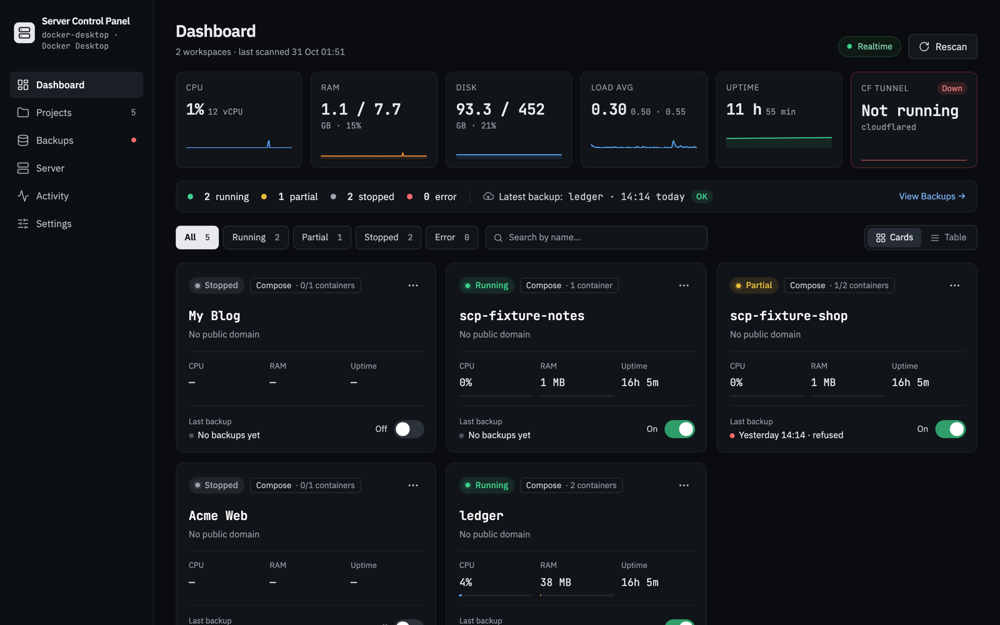
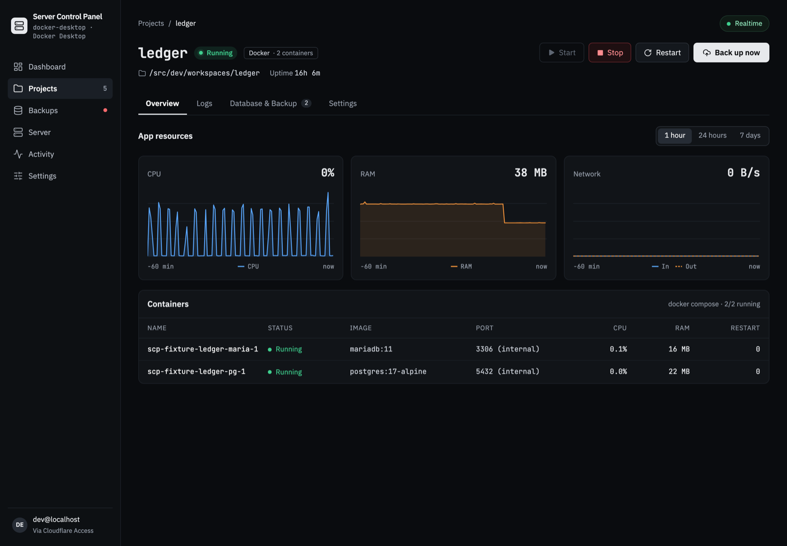
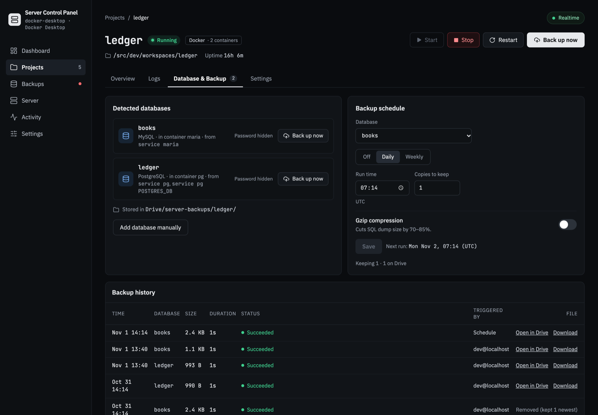
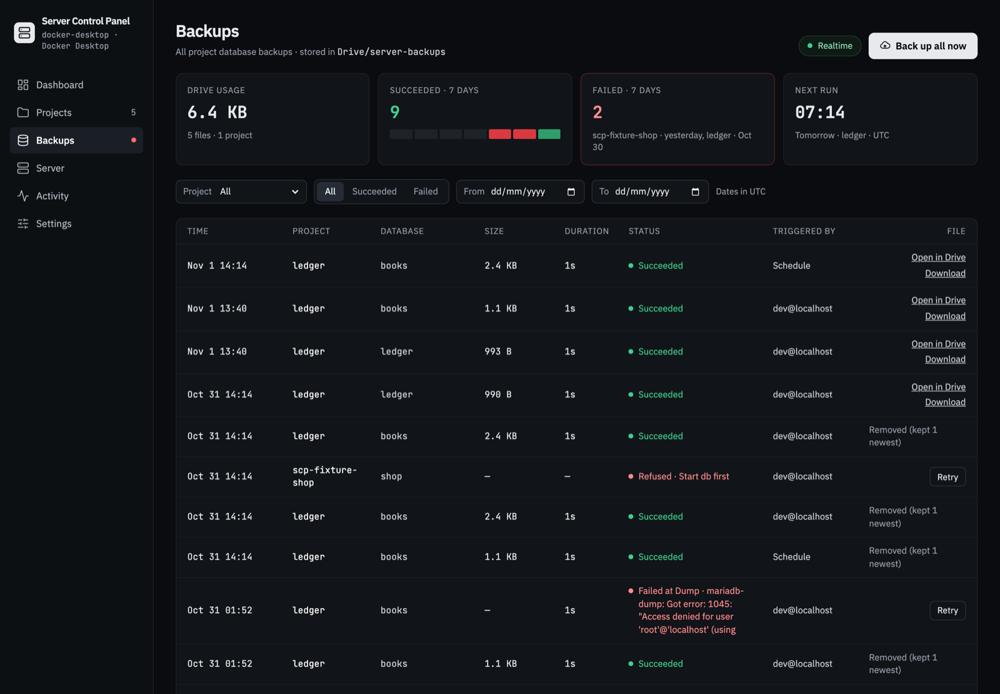
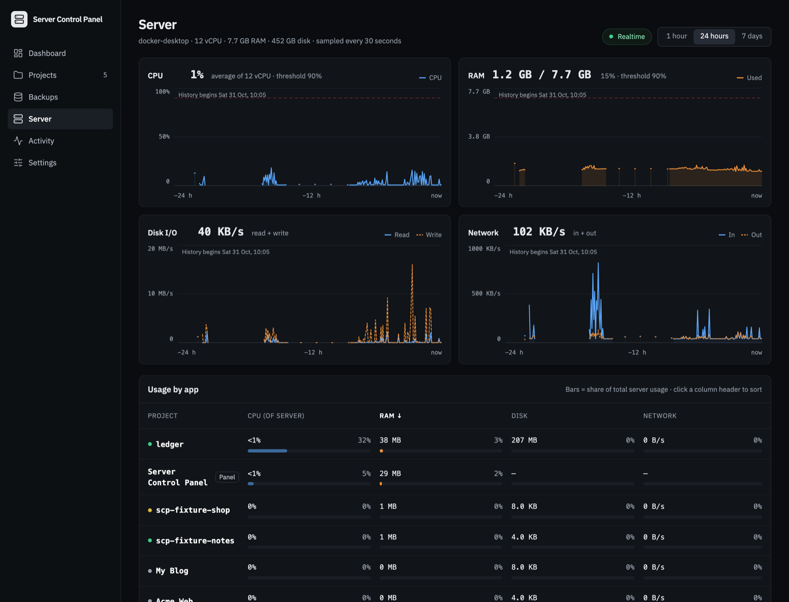
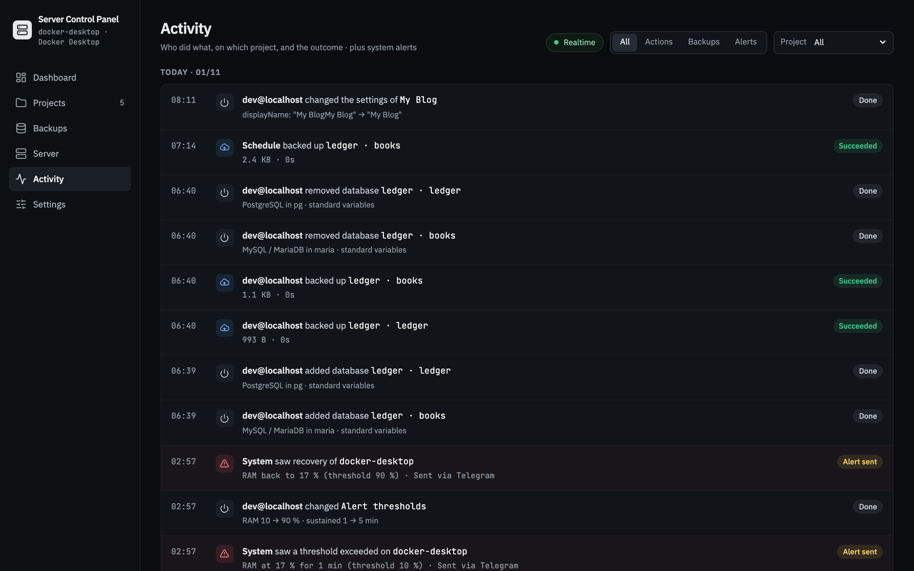
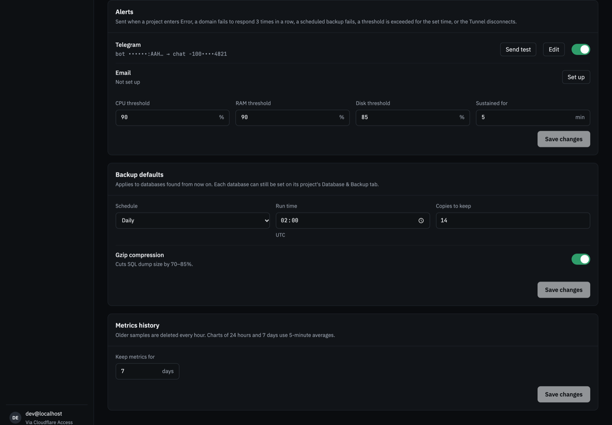
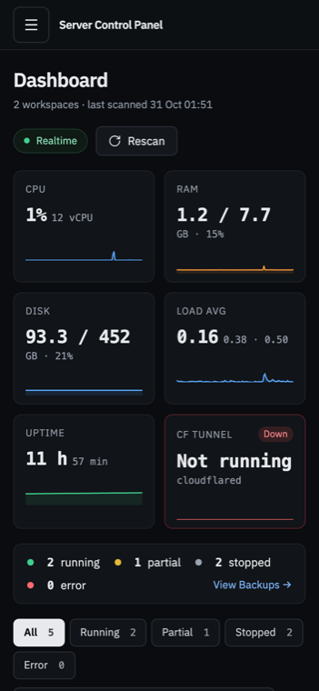
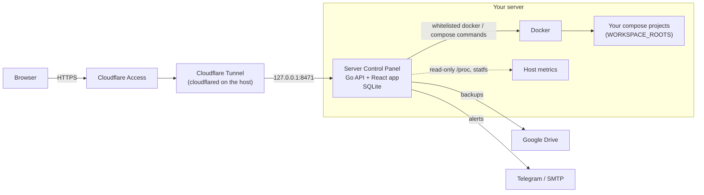

<div align="center">

# Server Control Panel

**A small, self-hosted control panel for the Docker Compose projects on one server.**
See what runs, start and stop it, read its logs, back up its databases to Google Drive and get told when something breaks, from any browser, behind Cloudflare Access.

[](https://github.com/daniel-vuky/server-control-panel/actions/workflows/ci.yml)
[](https://github.com/daniel-vuky/server-control-panel/actions/workflows/release.yml)
[](LICENSE)




</div>

## Why

A small server often runs a handful of apps, each a `docker compose` project in its own folder. Keeping them healthy usually means an SSH session, a few `docker compose ps`, a hand-written cron job for database dumps, and finding out from a user that the site is down.

Server Control Panel puts that on one page. It is one Go binary with an embedded web app, it runs next to your projects as a compose project itself, and it is built to stay out of the way:

- **No shell, no free-form commands.** Only a fixed list of `docker` / `docker compose` commands can run, with validated arguments (ADR 0005).
- **Never exposed directly.** It binds `127.0.0.1` only and is reached through a Cloudflare Tunnel, behind Cloudflare Access (ADR 0006).
- **Secrets stay put.** Database passwords are read inside the database container; values from `.env`, `compose.yaml` and `env_file`s are masked in every log line, error and API answer.
- **Light.** A single process with SQLite, under 384 MB of memory, sampling every 30 seconds.

## Features

| | |
|---|---|
| **Discover** | Point it at your project folders. It finds every compose project (depth 1–3), detects its services and databases, and lets you choose what to track. Rescans pick up new and missing projects. |
| **Monitor** | Live status for every project (Running, Partial, Stopped, Error…), per-container CPU, RAM, restarts and health, pushed over Server-Sent Events. Server CPU, RAM, disk, load, uptime and Cloudflare Tunnel state at a glance. |
| **Control** | Start, stop and restart with confirmation, per-project locks and clear outcomes. Live logs per service, with search, level filters and download. |
| **Back up** | PostgreSQL, MySQL / MariaDB and MongoDB dumps to Google Drive, on demand or on a daily / weekly schedule, gzip-compressed, with a set number of copies kept. "Back up all now", full history, download and retry. Databases the scan missed can be added by hand. |
| **History** | Server and per-project charts over 1 hour, 24 hours or 7 days, kept 7–30 days, plus a usage-by-app ranking. |
| **Alerts** | Telegram and email when a project enters Error, a public domain stops answering, a scheduled backup fails, CPU / RAM / disk stay over threshold, or the tunnel drops. One alert per incident, with a recovery message. |
| **Activity** | A timeline of who did what, on which project, and every alert raised. |
| **Anywhere** | A first-run setup that goes from an empty panel to a working dashboard, and a phone layout for checking and starting or stopping projects on the move. |

## Screenshots

<table>
  <tr>
    <td width="50%"><p align="center"><sub>Project overview: resources and containers</sub></p></td>
    <td width="50%"><p align="center"><sub>Databases, schedule and backup history</sub></p></td>
  </tr>
  <tr>
    <td width="50%"><p align="center"><sub>All backups across projects</sub></p></td>
    <td width="50%"><p align="center"><sub>Server metrics and usage by app</sub></p></td>
  </tr>
  <tr>
    <td width="50%"><p align="center"><sub>Activity timeline</sub></p></td>
    <td width="50%"><p align="center"><sub>Alert channels, thresholds and backup defaults</sub></p></td>
  </tr>
</table>

<p align="center"><br><sub>The dashboard on a phone</sub></p>

## How it works



- **Backend** (`cmd/panel`, `internal/`): Go 1.27, the standard `net/http` mux, SQLite through `modernc.org/sqlite` (no cgo). Every process runs through one package, `internal/runner`, from a registry of fixed argv templates. Background work (status polling, metrics sampling, backup worker and scheduler, alert watcher) runs inside the same process.
- **Frontend** (`web/`): React 19, React Router, Vite and Tailwind CSS 4, built into the binary. No UI or chart library: charts are hand-drawn SVG.
- **Live updates** over Server-Sent Events: one shared Docker read every 5 seconds while someone is watching.
- **Deployment**: a published container image (GHCR, tagged `latest` and `sha-<commit>`) run as a compose project, with a pull-based updater that applies new releases; pinning a `sha-` tag rolls back.

Every design decision is recorded in [`docs/decisions/`](docs/decisions/).

## Getting started

### Requirements

- A Linux server with Docker and the compose plugin (2.20 or newer), and a user in the `docker` group.
- A Cloudflare account with a Tunnel to the server and an Access application in front of the panel's hostname ([guide](docs/cloudflare-access.md)).
- Optional: a Google Cloud OAuth client for Drive backups ([guide](docs/google-drive.md)), a Telegram bot and/or an SMTP server for alerts ([guide](docs/alerts.md)).

### Install

On the server, as that user:

```sh
curl -fsSL https://raw.githubusercontent.com/daniel-vuky/server-control-panel/main/deploy/install.sh | bash
```

The installer creates `/opt/server-control-panel`, asks for the Cloudflare Access team domain and AUD tag, the folders that hold your projects, and the optional Drive settings, then starts the panel and its updater. Open the panel's hostname and the first-run setup walks you through adding a workspace, choosing projects and connecting Google Drive.

Updates, rollback, adding a workspace root and uninstalling are covered in the [deployment guide](docs/deploy.md).

### Configuration

Settings live in `/opt/server-control-panel/panel.env`; the installer writes the required ones.

| Variable | Purpose |
|---|---|
| `CF_ACCESS_TEAM_DOMAIN`, `CF_ACCESS_AUD` | Cloudflare Access team domain and application audience tag. Required: every request is verified against them. |
| `WORKSPACE_ROOTS` | Comma-separated folders that may become workspaces. Nothing outside them is ever scanned. |
| `PANEL_SECRET_KEY` | 32-byte key that seals the Google Drive token and the Telegram bot token. Generated by the installer. |
| `PANEL_PUBLIC_URL` | The panel's public `https://` origin, used for the Google OAuth redirect and links in alerts. |
| `GOOGLE_CLIENT_ID`, `GOOGLE_CLIENT_SECRET` | OAuth client for Google Drive backups (both or neither). |
| `SMTP_HOST`, `SMTP_PORT`, `SMTP_USERNAME`, `SMTP_PASSWORD`, `SMTP_FROM` | Mail server for email alerts (optional). |
| `TZ` | Server time zone for schedules and displayed times (detected by the installer). |
| `CLOUDFLARED_METRICS` | cloudflared's metrics address, if you moved it off the default ports. |
| `PANEL_ADDR`, `PANEL_DATA_DIR` | Listen address (always `127.0.0.1:<port>`, default `127.0.0.1:8471`) and data directory. |

## Development

The host needs only Docker and `make`: Go, Node, pnpm and every tool run in a dev image ([ADR 0009](docs/decisions/0009-run-the-development-toolchain-in-docker.md)).

```sh
make dev     # Go hot reload (Air) + Vite, UI at http://localhost:5173, signed in as dev@localhost
make test    # Go tests (release and dev build tags), then the web tests
make lint    # golangci-lint, Biome, the TypeScript typecheck, shellcheck
make ci      # lint, test, build, and check that generated types are committed
make build   # the release binary at bin/panel
make image   # the production image scp-panel:local
```

`make dev` scans `dev/workspaces/` (gitignored): put a few compose projects there to try the panel locally. In a `dev` build, Google Drive and the alert channels are fakes, so no account is needed.

Project layout:

```
cmd/panel/        entry point: wires the services and the HTTP server
internal/api/     routes, request validation, JSON types (generated into web/src/api/types.gen.ts)
internal/runner/  the only package that runs processes: whitelisted docker commands and dump scripts
internal/scan/    workspace scanner, compose and database detection, secret masks
internal/control/ project lifecycle, locks and the live-state hub
internal/backup/  backup manager, worker, scheduler and retention
internal/drive/   Google Drive client (and a fake for dev)
internal/metrics/ host and container sampling, history, system information
internal/alerts/  alert channels, notifier and watchers
internal/store/   SQLite schema, migrations and queries
web/              the React app
deploy/           compose project, install / update / uninstall scripts and their tests
docs/             guides and architecture decision records
```

`CLAUDE.md` holds the detailed architecture notes, and `knowledge/` the product spec and design references.

## Documentation

- [Deploy the panel](docs/deploy.md): install, updates, rollback, uninstall, troubleshooting
- [Set up Cloudflare Access](docs/cloudflare-access.md)
- [Set up Google Drive backups](docs/google-drive.md)
- [Set up alerts](docs/alerts.md)
- [Architecture decision records](docs/decisions/)

## License

[MIT](LICENSE) © 2026 Daniel Vu
